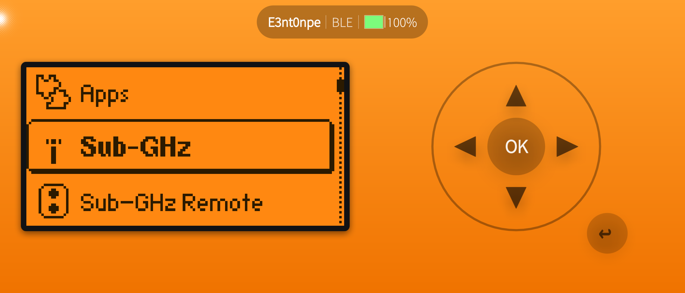

# sFlipper

An **unofficial** native [Flipper Zero](https://flipperzero.one) client for
**Sailfish OS**, with a Silica interface. It speaks the same Flipper RPC
(protobuf) protocol the official apps use, over both **USB-C** (CDC-ACM serial)
and **Bluetooth LE** (BlueZ GATT) — no Android App Support required.



## What works

* **Two transports** — USB-C and Bluetooth LE, selectable at connect time.
* **Device info & battery** — full `device_info` / `power_info` read-out.
* **Screen mirroring & remote control** — the live 128×64 display, the five
  keys as buttons, and touch gestures directly on the mirrored screen
  (swipe = direction, tap top/bottom = ▲/▼, tap centre = OK).
* **File manager** — browse the SD card and internal storage, delete, navigate.
* **Trigger saved signals** — open a stored Sub-GHz / Infrared / NFC / RFID
  file in the matching Flipper app.
* **Rename** — change the Flipper's display + Bluetooth name.
* **Firmware update** — install a package already on the SD, or upload an update
  package from the phone and install it (USB-C).
* **USB device library** — with the phone in USB host mode (OTG), inspect
  attached USB peripherals: full descriptors, decoded HID report descriptors,
  and VID/PID + chip-vendor lookup (`usb.ids`), saved to an editable list.

## Requirements

* Sailfish OS (aarch64; developed/tested on 5.x).
* A Flipper Zero running firmware with the RPC protocol. The custom-name feature
  uses the Unleashed *NameChanger* file (`/ext/dolphin/name.settings`).

## Connecting

### USB-C
Plug the Flipper into the phone (USB host mode). A bundled udev rule
(`data/99-flipper.rules`, installed to `/etc/udev/rules.d/`) makes the serial
node world-accessible, so no `dialout` membership is needed.

### Bluetooth LE
Pair **once** in *Settings → Bluetooth* — the system agent handles the passkey
shown on the Flipper. The app then finds the bonded device itself. On connect it
first drops any stale link and re-establishes a fresh one (a reused BLE link
leaves the Flipper's RPC session unresponsive), and it disconnects again on
close. Use **one transport at a time**: the Flipper does not advertise or serve
RPC over BLE while USB is connected.

## Building

With the Sailfish SDK (Platform SDK / `mb2`):

```sh
mb2 -t SailfishOS-<version>-aarch64 build
```

This produces an RPM under `RPMS/`. Install it on the device with
`devel-su pkcon install-local <rpm>`. The Flipper protobuf sources are vendored
and pre-generated (`lib/`), so no extra tooling is needed to build.

## Notes & caveats

* **Firmware upload is USB-C only** — BLE has no flow control for a ~14 MB
  transfer; the file manager's smaller writes work on either transport.
* **Renaming changes the BLE MAC** on Unleashed (it is derived from the name),
  so you have to pair again after a rename.
* The app runs **unsandboxed** (no Sailjail profile) so it can reach
  `/dev/ttyACM0` and the `org.bluez` system bus.

AI assisted development

## Attribution & licence

* App icon: dolphin line-art from
  [Arcticons](https://github.com/Arcticons-Team/Arcticons) (Apache-2.0),
  recoloured onto an orange tile.
* Bundled: [nanopb](https://github.com/nanopb/nanopb) (zlib) and the
  [flipperzero-protobuf](https://github.com/flipperdevices/flipperzero-protobuf)
  definitions.
* Protocol details cross-checked against the open-source
  [qFlipper](https://github.com/flipperdevices/qFlipper) (GPL-3.0); no code was
  copied.

Licensed **GPL-3.0-or-later** — see [LICENSE](LICENSE) and
[ATTRIBUTION.md](ATTRIBUTION.md).

## Disclaimer

Unofficial and not affiliated with or endorsed by Flipper Devices Inc.
"Flipper Zero" and the dolphin mascot are trademarks of their respective owners.
